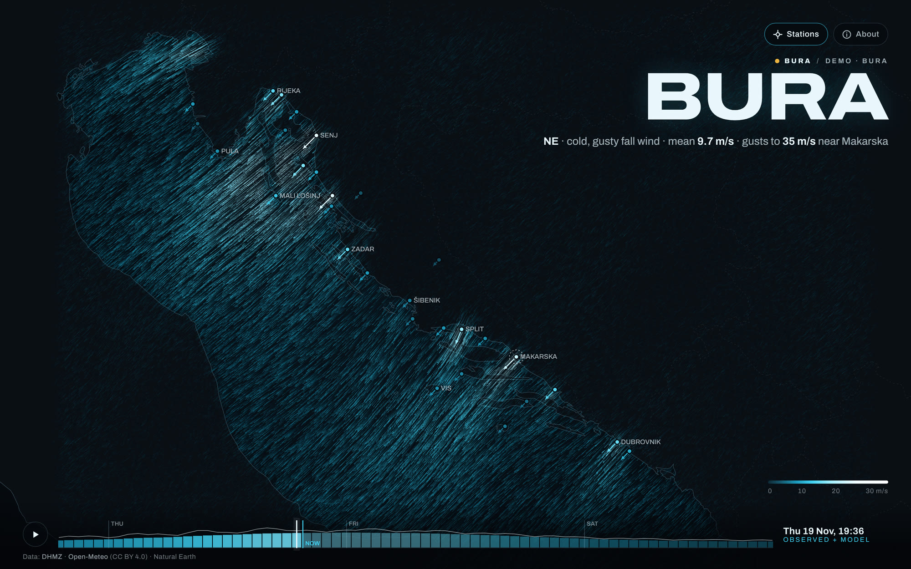
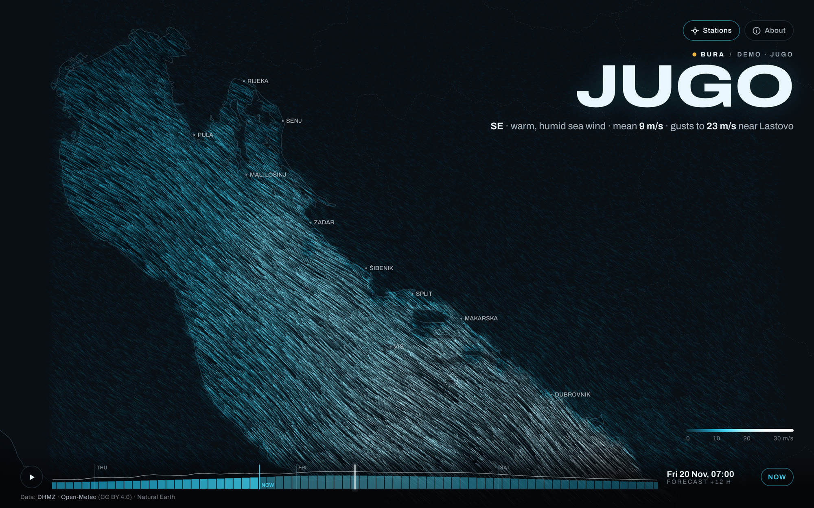
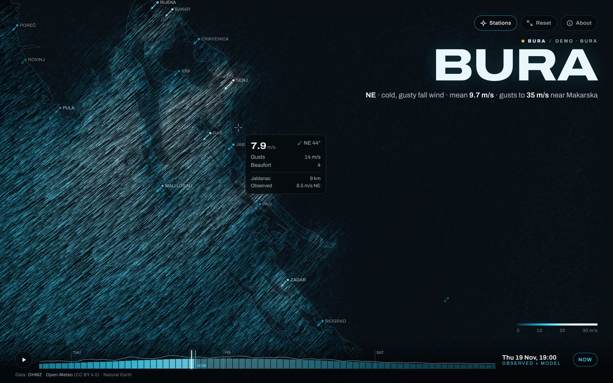
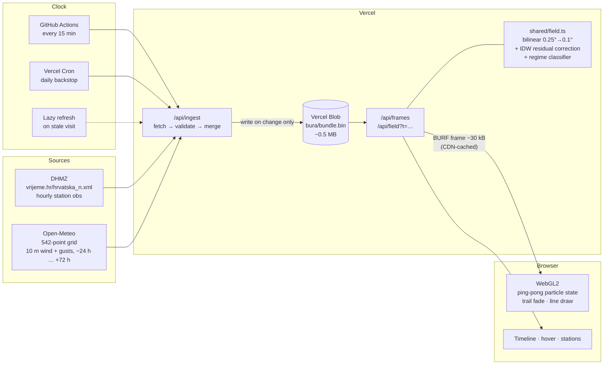

# Bura

**Live wind over the Croatian Adriatic, drawn as a GPU particle field.**

Tens of thousands of particles flow along the current 10 m wind field over the coast and islands. Colour shows speed and the fading trails show direction. When a **bura** (cold, gusty NE fall wind) or a **jugo** (warm, steady SE wind) is blowing, you can see it at a glance. A label names the current regime and where the strongest gust is.



| Jugo | Zoomed into Kvarner, with stations and hover readout |
| --- | --- |
|  |  |

`docs/bura.mp4` is a 10-second recording of the field evolving over 25 hours.

---

## How it works



1. **Ingest** (`server/ingest.ts`) runs every 15 minutes. It fetches the DHMZ XML (hourly, current hour only) and, every ~3 hours, an Open-Meteo grid. It merges them into one binary bundle: 96 hours of model wind plus 30 hours of station history. It writes to storage **only when something changed**, about 30 writes a day.
2. **Serve** (`api/field.ts`) builds each requested hour on demand. It resamples the model to 0.1°, blends in the station observations for that hour, and returns a compact int16 frame. `/api/frames` lists the available hours with a regime summary for each, which drives the timeline sparkline.
3. **Render** (`src/gl/particles.ts`) advects particles on the GPU, interpolating smoothly in space and between hourly frames, so scrubbing and live playback stay continuous.

The browser never calls DHMZ or Open-Meteo directly.

### Interpolation

The model gives a smooth but coarse field (ICON-EU/ICON-D2 via Open-Meteo, sampled at 0.25°). The stations give truth at points but are sparse and coastal. Bura is a very local wind: jets 10–20 km wide below mountain gaps that a 25 km grid smears out. So the stations are used to **correct** the model rather than replace it:

- **Resample:** bilinear from the 0.25° model grid to the 0.1° output grid (`shared/interp.ts → resample`). Outside the core box, nodes are fetched on a 0.5° lattice and filled bilinearly (`fillFromLattice`). This keeps each fetch at 542 locations, under Open-Meteo's 600-per-minute fair-use limit.
- **Residuals:** at every station, r = observed − model, as a **u/v vector**. Speed and direction are never interpolated directly, so opposing winds can't average into a wrong-angled breeze.
- **IDW with a background weight:**

  ```
  field(x) = model(x) + Σ wᵢ·rᵢ / (w₀ + Σ wᵢ)
  wᵢ = (1 − (dᵢ/R)²)² / dᵢ²      R  = 45 km  (compact support)
  w₀ = 1 / L²                    L  = 12 km  (background length scale)
  ```

  Close to a station, wᵢ ≫ w₀ and the field matches the observation exactly. Far from every station, the correction fades smoothly back to the model. Plain Shepard IDW would extend the nearest station's error over the whole open sea, and the w₀ term stops that. This is a single pass of the classic Cressman/Barnes "successive correction" idea, with Shepard weights.
- **Into the forecast:** the latest residuals keep influencing the next hours with an e-folding time of 3 h (a crude nowcast). After 9 h the forecast is pure model.
- **Gusts:** DHMZ reports no gusts, so the model gust is rescaled by the corrected-to-model speed ratio (clamped to 0.5–3×) and is never lower than the mean wind.
- **Quality control:** mountain-top stations (Zavižan, Parg, …) are excluded because their winds don't represent the surface field. Residuals are clamped to ±20 m/s, and calm or missing reports are handled explicitly.

All of it is plain TypeScript in `shared/`, used by the server and, in demo mode, by the browser. Tests are in `tests/interp.test.ts` and `tests/pipeline.test.ts`.

### GPU advection

Particle positions live in an RGBA8 texture, two bytes per axis, which gives 1/65025 of the domain (~10 m). WebGL1-class float render targets are unreliable on mobile, and this encoding works everywhere. Each frame:

| Pass | What it does |
| --- | --- |
| **Update** (ping-pong `stateA → stateB`) | Fragment shader decodes a position and samples the wind from two `RG16F` textures (hourly frames A and B), using hardware bilinear filtering in space and a `mix()` in time. It converts m/s to degrees (longitude ÷ cos φ) and steps. Particles respawn randomly, more often in fast flow, so coverage stays even. |
| **Fade** (ping-pong `trailA → trailB`) | Redraws the previous trail image at ~96 %, floor-quantised so trails fully reach zero instead of leaving 1/255 ghosts. |
| **Draw** | One `GL_LINES` segment per particle (old → new), generated from `gl_VertexID` with no vertex buffers. Colour comes from the speed ramp, generated into GLSL from the same stops as the legend. Segments are dimmed over land (rasterised land mask texture) and at the domain edge. |
| **Blit** | Premultiplied alpha onto the canvas, over a static 2D-canvas basemap. |

The CPU only sets a few uniforms per frame. The particle count adapts to the device: 32k on desktop and 8k on touch devices, dropping a tier if frame time stays above 25 ms for two 1.5 s windows (background-throttled frames are ignored). `?n=65536` pins it. Step size is defined in screen pixels per m/s, so motion looks the same at every zoom level and frame rate.

### Regime label

`shared/regime.ts` samples the corrected field at 28 coastal points from Poreč to Cavtat and takes the speed-weighted resultant direction and mean speed:

- calm when the mean is under 3 m/s and no gust reaches 10 m/s
- variable when steadiness is under 0.45
- otherwise by sector on the traditional Adriatic wind rose: tramontana N, **bura** NE (20–80°), levant E, **jugo** SE (110–170°), oštro S, lebić SW, pulenat W, maestral NW

The strongest gust is reported with the nearest place name.

---

## Data sources and terms

Checked on 19 November 2026.

| Source | What | Access | Terms |
| --- | --- | --- | --- |
| **DHMZ**, Croatian Meteorological and Hydrological Service | `https://vrijeme.hr/hrvatska_n.xml`: hourly observations from dozens of stations (name, lat/lon, temperature, humidity, pressure, wind direction as a compass point, wind speed in m/s). Local time (`<DatumTermin>`). **No gusts, no history:** only the current hour. | Public XML, no key. Listed on [meteo.hr → XML podaci za korisnike](https://meteo.hr/proizvodi.php?section=podaci&param=xml_korisnici). The feed has served a mismatched TLS certificate in the past, so the client falls back to HTTP for this public, read-only file. | [Open Licence of the Republic of Croatia](https://data.gov.hr/otvorena-dozvola): free reuse with attribution. Data from DHMZ's database (archives, history) is a paid service. That's why this app builds its own 24 h history by polling. |
| **Open-Meteo** | `/v1/forecast` with `wind_speed_10m, wind_direction_10m, wind_gusts_10m`, `past_days=1`, `forecast_days=3`, multi-location. `best_match` selects the best available model per point (ICON-D2/ICON-EU over the Adriatic). | Free, no key. | Free tier is **non-commercial**: < 10,000 calls/day, 5,000/hour, 600/minute, where each location counts as a call. Data is [CC BY 4.0](https://creativecommons.org/licenses/by/4.0/) with attribution required. This app uses ~542 calls per refresh × 8 refreshes a day ≈ 4,300/day. |
| **Natural Earth** | 10m land, minor islands, land borders | Downloaded once at build time (`npm run coast`) | Public domain |

Attribution is shown in the page footer and the About dialog. Other DHMZ feeds checked: `more_n.xml` (sea stations) and `temp_vode.xml` (sea temperature). They aren't used yet, but `more_n.xml` is the obvious next source for offshore wind.

> **Development note:** the sandbox this was built in couldn't reach `vrijeme.hr` or `api.open-meteo.com`, so parsers and assembly are tested against fixtures that follow the documented formats (`tests/fixtures/`). Run `npm run ingest` once on a normal connection to check against the live feeds.

---

## Running it

```bash
npm install
npm run seed:demo        # offline: write a synthetic bundle to .data/ (bura | jugo | maestral)
npm run ingest           # or: fetch real DHMZ + Open-Meteo data into .data/
npm run dev              # Vite + the API routes on http://localhost:5173
npm test                 # vitest: interpolation, parsers, ingest pipeline, codecs
npm run typecheck && npm run build
```

Without any data the front end falls back to the synthetic bura scenario and says so in the header. `?demo=bura|jugo|maestral` forces a scenario at any time; the case-study screenshots use these.

### Deploying (Vercel Hobby)

1. Import the repo into Vercel. The framework (Vite) and `api/` functions are detected, and `vercel.json` pins functions to `fra1` (Frankfurt, close to DHMZ).
2. **Storage → Create Blob store** and connect it to the project. This sets `BLOB_READ_WRITE_TOKEN`.
3. Add the env var `CRON_SECRET` (any long random string).
4. In GitHub → *Settings → Secrets and variables → Actions*: add the secret `CRON_SECRET` (same value) and the variable `BURA_URL` (`https://<your-app>.vercel.app`).
5. Run the *ingest* workflow once by hand (*Actions → ingest → Run workflow*, tick **force**).

**Why GitHub Actions?** Vercel Hobby cron jobs run at most once a day. The daily Vercel cron stays as a backstop, and visitors trigger a background refresh (`waitUntil`) if the data is more than 75 minutes old. GitHub disables scheduled workflows in repos with no activity for 60 days, so re-enable it if the timeline goes stale.

**Why one blob object?** Hobby includes 2,000 Blob writes a month. Writing per frame or per run would exceed that, but one write per change (about 30 a day) fits. Reads are served from the function's memory cache and the CDN (`s-maxage=120, stale-while-revalidate=1800`).

### API

| Endpoint | Returns |
| --- | --- |
| `GET /api/frames` | JSON: available hours (−24 h … +48 h), each with `kind` (`obs`, `model` or `forecast`) and a regime summary |
| `GET /api/field?t=<ISO\|unix\|latest>` | `application/octet-stream` "BURF" frame: `[magic][u32 len][JSON header][pad][int16 u, v, gust × 91·51]`, 0.01 m/s units, ~30 kB. Add `&format=json` for debugging. |
| `GET /api/ingest` | Runs an ingest pass. Requires `Authorization: Bearer $CRON_SECRET`. `?force=1` refetches the model. |

---

## Project layout

```
api/            Vercel functions (thin: parse request → service → response)
server/         DHMZ parser, Open-Meteo client, ingest job, storage (Blob | file)
shared/         Pure TS used on both sides: grid, interpolation, field builder,
                regime classifier, binary codec, land mask, demo scenarios
src/            Front end: WebGL2 particles, basemap/overlay canvases, UI
scripts/        Coastline builder (Natural Earth → 24 kB JSON), local ingest, demo seeding
tests/          Vitest suites + DHMZ XML fixture
```

## Accessibility and performance

- The text renders before any script runs (the regime label is a real `<h1>`, updated via `aria-live`). The canvas has a descriptive `aria-label`, and the time slider has `aria-valuetext`.
- Keyboard: <kbd>Space</kbd> play/pause, <kbd>←</kbd>/<kbd>→</kbd> step hours, <kbd>S</kbd> stations, <kbd>0</kbd> reset view.
- `prefers-reduced-motion` gets slower, shorter trails and fewer particles.
- No runtime dependencies in the client: about 25 kB of gzipped JS including the coastline. Demo scenarios are generated in a Web Worker. Shader linking uses `KHR_parallel_shader_compile` and waits for idle time after first paint. Archivo is self-hosted and preloaded (latin + latin-ext subsets).
- CPU-emulated WebGL (SwiftShader, llvmpipe: the setup Lighthouse and PageSpeed use) is detected and drops to 4k particles at 24 fps.
- Lighthouse (mobile, emulated WebGL): **Performance 92 · Accessibility 100 · Best Practices 100 · SEO 100**.

## Limitations and next steps

- 0.1° output and a 0.25° model can't resolve the narrowest bura jets. The station correction adds detail only where there are stations. A higher-resolution source (DHMZ's ALADIN-HR, 2 km) isn't openly available as a feed.
- `more_n.xml` (offshore and lighthouse stations) would improve the open sea.
- The forecast nowcast blend is deliberately simple. A proper approach would weight stations by their past skill.

## Credits

Built by [Antonio Brkić](https://antoniobrkic.com). Data © DHMZ (Open Licence RH) and Open-Meteo.com (CC BY 4.0). Coastline from Natural Earth. Particle technique inspired by Vladimir Agafonkin's *How I built a wind map with WebGL*.

MIT licensed. See [LICENSE](LICENSE).
